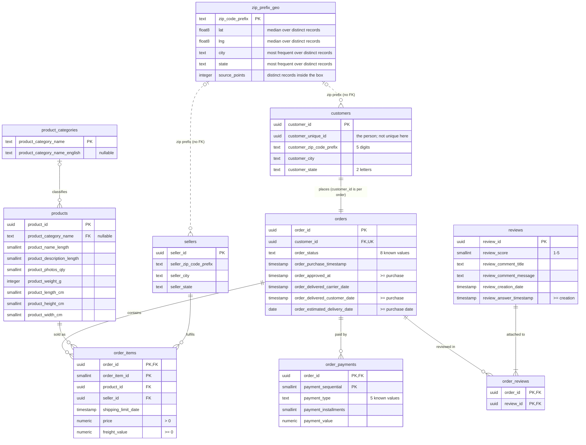

# Entity relationship diagram (schema `core`)

Drawn from `sql/core/01_tables.sql` and `sql/core/02_keys.sql`. Solid lines are enforced foreign
keys (deferrable, checked immediately except inside the publish transaction; so is the unique key on
`orders.customer_id`); dotted lines are join
paths that are deliberately **not** foreign keys (see [decisions.md](decisions.md#geolocation)).

## Pipeline schemas

| Schema | Contents | Lifetime |
|---|---|---|
| `raw` | One all-text, UNLOGGED table per CSV file | Replaced on every load |
| `dq` | `check_results`: status, violation count and sample per check per load | Persistent |
| `meta` | `load_runs` (status is the commit marker), `load_files` (SHA-256 manifest per load), `load_changes` (rows inserted, updated, deleted per table per load) | Persistent |
| `core` | The published, constrained model above | Tables created once by `olist-dbe init`; each load MERGEs their rows in one transaction |
