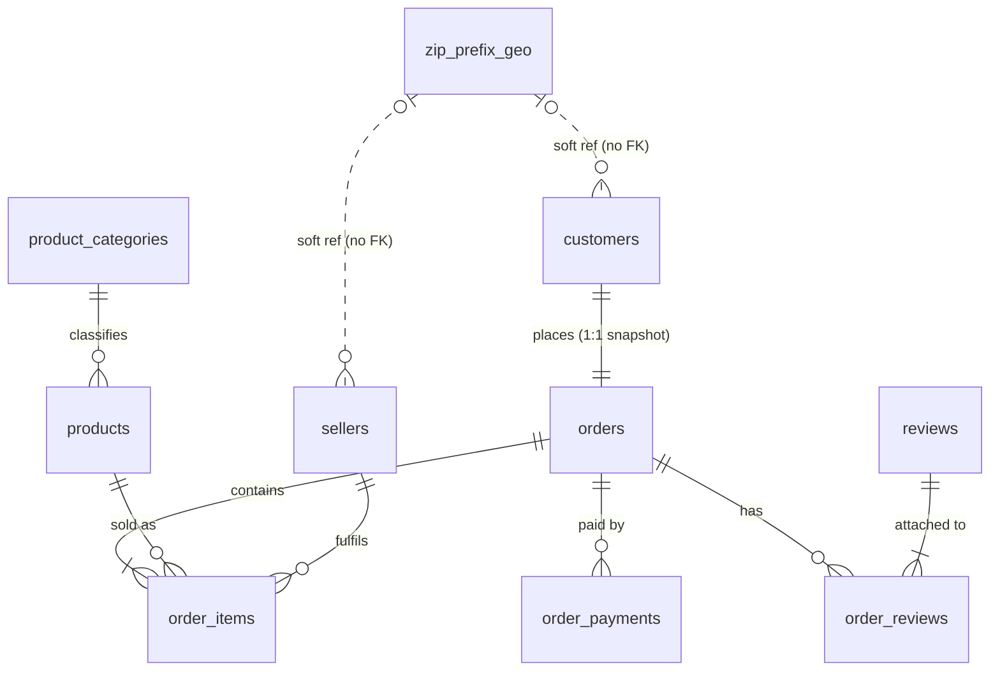

# Olist 数据库工程项目：数据评估与实施路线图

> 依据：2026-10-29 对 `D:\project` 下 9 个原始 CSV 的只读分析（脚本 `scripts/profile_olist.py`），以及你的 `analysis.sql` / `part2.sql` / `aaa.sql`。
> 未检查：本机 PostgreSQL 18 里的库（需要密码，没有连接）。`D:\specialized_eval_sealed` 只有加密的 Gold 归档，未触碰。
> 下文所有数字都是实测值。
>
> **2026-10-29 更新：** 本文是实施前的评估，保留原样。文中建议的 `core_next` + schema 互换发布方案已被替换：双连接测试证明它对 REPEATABLE READ 读者不是 MVCC 安全的，现在改为在单个事务里用 MERGE 发布到固定的 core 表。原因与证据见 [decisions.md](decisions.md#load-pipeline)。

---

## 1. 数据实测概况

| 表 | 行数 | 说明 |
|---|---:|---|
| geolocation | 1,000,163 | 占总行数 64%，无主键，大量重复 |
| order_items | 112,650 | |
| order_payments | 103,886 | |
| customers | 99,441 | 与 orders 严格 1:1 |
| orders | 99,441 | |
| order_reviews | 99,224 | |
| products | 32,951 | |
| sellers | 3,095 | |
| category_translation | 71 | 唯一带 UTF-8 BOM 的文件 |
| **合计** | **1,550,922** | 交易核心 5 张表约 51.5 万行 |

**结论：** 数据量很小，整库可以放进内存。查询优化必须配合 scale factor 实验，否则测不出可信的差异。

---

## 2. 已验证的数据问题（数据质量模块的素材）

### 2.1 键与关系

| 发现 | 数值 | 设计影响 |
|---|---|---|
| 核心外键（orders→customers，items→orders/products/sellers，payments→orders，reviews→orders） | 孤儿行 = 0 | 可以全部强制 FK |
| `customer_id` 与订单 1:1 | 每个 customer_id 恰好 1 单 | customers 实际是"订单收货人快照"，真正的客户是 `customer_unique_id` |
| `customer_unique_id` | 96,096 个；2,997 个复购（3.12%），单人最多 17 单 | 用 customer_id 算复购率 = 0.00% |
| `review_id` 不唯一 | 789 个 review_id 挂在多个订单上，共 1,603 行 | 789/789 组的评分、文本、日期完全相同，属于源数据把一条评价复制到多个订单 |
| 一单多评 | 547 个订单有 >1 条评价 | orders × reviews JOIN 会扇出（99,224 行 vs 98,673 个订单） |
| 品类翻译缺失 | `pc_gamer`、`portateis_cozinha_e_preparadores_de_alimentos`（13 个商品） | 强制 FK 会失败 |
| 客户邮编不在 geolocation | 157 个前缀 / 278 个客户 | 不能对 geolocation 建 FK |
| 卖家邮编不在 geolocation | 7 个前缀 / 7 个卖家 | 同上 |
| 邮编前导零 | 24.1% 的客户邮编以 0 开头（23,995） | 必须存成 `char(5)`/`text`，按整数加载会丢零，JOIN 也会失败 |

### 2.2 geolocation

- 19,015 个邮编前缀，单个前缀最多 1,146 行
- 完全重复的行：261,831 行（去重后 738,332 行）
- 42 个坐标点落在巴西经纬度范围之外
- 8,556 个前缀对应多种城市拼写（重音、大小写等）

### 2.3 订单时间线（宜作为警告，而非约束）

| 检查 | 违规数 | 能否做成 CHECK 约束 |
|---|---:|---|
| approved_at < purchase | 0 | 可以 |
| delivered_customer < purchase | 0 | 可以 |
| estimated_delivery < purchase | 0 | 可以 |
| carrier_date < approved_at | 1,359 | 不行，记为警告 |
| carrier_date < purchase | 166 | 不行，记为警告 |
| delivered_customer < carrier_date | 23 | 不行，记为警告 |
| status=delivered 但送达时间为空 | 8 | 警告 |
| status=canceled 但有送达时间 | 6 | 警告 |

### 2.4 订单完整性

- 775 个订单没有任何 item（unavailable 603、canceled 164、created 5、invoiced 2、shipped 1）
- 1 个订单没有支付记录；768 个订单没有评价
- 1,278 个订单包含多个卖家

### 2.5 金额

- 303 个订单的实付金额 ≠ Σ(price + freight)，最大差 182.81
  - 多付的 264 单中，94% 是分期（installments > 1），推测是分期利息
  - 少付 39 单
- `payment_type = not_defined` 3 笔；`payment_value = 0` 9 笔；`installments = 0` 2 笔
- `freight_value = 0` 383 行；`price <= 0` 0 行

### 2.6 其他

- **时间覆盖不连续：** 2016-09 有 4 单，**2016-11 整月没有订单**，2016-12 有 1 单；2018-09 只有 16 单，2018-10 只有 4 单。完整的分析窗口是 2017-01 至 2018-08。
- `shipping_limit_date` 最大到 2020-04-09，晚于数据集结束时间。
- 74 条评价的创建时间早于下单时间，其中 45 条属于跨订单共享的 review_id。
- products：610 个商品没有品类；4 个重量为 0；列名拼错（`product_name_lenght`、`product_description_lenght`）。
- 卖家表里有 17 个邮编前缀对应不止一个州。
- **原始文件的行顺序和下单时间完全不相关**（Spearman = −0.002）。按文件顺序加载后 BRIN 索引无效，这本身就是一个好实验。

---

## 3. 你现有 SQL 的正确性问题

`analysis.sql` 是很好的 benchmark 负载来源（是你自己的查询，不是 Gold SQL），但里面有几处正确性问题，修复过程本身就是 README 里的亮点：

1. **月度环比（MoM）跨过了缺失月份。** 2016-11 没有订单，`LAG()` 会让 2016-12 直接和 2016-10 比；首尾的不完整月份（4 单、1 单、16 单、4 单）会产生极端增长率。
   修复：用 `generate_series` 生成月份序列再 LEFT JOIN，并限定在 2017-01 至 2018-08。
2. **收入包含取消和无货订单。** 非 delivered 订单上有 2,453 行 item，canceled/unavailable 订单的 price 合计 97,242.96。另外 freight 没有计入。
   修复：明确定义 GMV 和已交付收入两个口径。
3. **两个查询的"准时"定义不一致。** 第一个查询用时间戳比较，而 `estimated_delivery_date` 全部是 00:00:00，所以当天送达都会被算成"迟到"；第二个查询用日期差。**两种口径下判定不同的订单有 1,292 个。**
4. **orders × reviews 扇出。** 547 个订单有多条评价，789 条评价被复制到多个订单，平均分会被重复计算。
5. 第二个查询里，6 个"已取消但有送达时间"的订单会进入准时或迟到分组。
6. 各条语句之间没有分号，不能作为脚本整体执行。应拆成一条查询一个文件，才能单独测试。
7. 做得对的地方：cohort retention 用的是 `customer_unique_id`。

---

## 4. Schema 设计（依据实测证据）



关键决策：

| 决策 | 证据 |
|---|---|
| `orders.customer_id` 加 `UNIQUE` 约束，表达 1:1 关系 | 99,441 对 99,441，没有例外 |
| customers 保持每单一行，不拆出地址实体 | 250 个 `customer_unique_id` 有多个邮编、39 个跨州，所以 unique_id → 地址不是函数依赖 |
| **reviews 拆成 `reviews(review_id, score, text, dates)` + `order_reviews(order_id, review_id)`** | 以 (review_id, order_id) 为主键时，评价内容只依赖 review_id，**违反 2NF**（789/789 组内容完全相同）。这是本数据集唯一一个真正需要规范化的地方 |
| 品类表由"商品中出现的品类 ∪ 翻译表"生成，英文名可空 | 有 2 个品类缺少翻译。英文名留空并在 DQ 中标记，不自己编译名 |
| geolocation 原表留在 raw 层；core 层派生 `zip_prefix_geo`（每个前缀一行：剔除越界点后取中位数坐标，城市和州取众数） | 有 1M 行、26 万行完全重复、42 个越界点 |
| customers/sellers → zip_prefix_geo **不建 FK**，改用 DQ 检查 | 强制 FK 会拒掉 278 个客户和 7 个卖家 |
| 邮编列：`char(5)` + `CHECK (zip ~ '^[0-9]{5}$')` | 有前导零 |
| 金额列：`numeric(10,2)`；price 加 `CHECK (price > 0)`，freight 加 `CHECK (freight_value >= 0)` | 违规 0 行 |
| 订单时间：只把违规为 0 的三条规则做成 CHECK，其余放进 DQ 警告 | 见 2.3 |
| **外键列手动建索引** | PostgreSQL 不会自动给 FK 列建索引，`order_items.seller_id` / `product_id` 是天然的实验对象 |
| 订单状态用 CHECK 限定 8 个取值（或单独建查找表） | 实测只有 8 种状态 |

---

## 5. 系统架构

```
D:\project\*.csv (只读，SHA-256 清单)
        │  COPY（单事务）
        ▼
 raw.*      全 TEXT，1:1 镜像 CSV，带 load_id
        │  DQ 检查（阻断级 / 警告级）→ dq.check_results
        │  类型转换，坏行进入 dq.quarantine
        ▼
 core_next.*  带类型和约束的 3NF 表
        │  原子发布（单事务内 schema 互换）
        ▼
 core.*  ──► analytics 查询（sql/analytics/*.sql）
        │
        ├─► bench：基线 vs 优化，EXPLAIN JSON 存进 bench.runs
        ├─► synth：SF10 / SF50 合成扩容（明确标注为合成数据）
        └─► txlab：隔离的事务与并发测试 schema
```

**隔离：**

- 新建独立数据库 `olist_dbe` 和角色 `dbe_owner` / `dbe_ro`，不碰 `olist_blind_eval_v1` 和 `olist_abcd40_snapshot_v1`。
- 注意：新建数据库默认把 CONNECT 权限授予 PUBLIC。要检查两个评估库是否已经 `REVOKE CONNECT ... FROM PUBLIC`；如果没有，新角色也能连进去。由你决定是否收紧。
- 密码放在 `%APPDATA%\postgresql\pgpass.conf` 或环境变量里，仓库只提交 `.env.example`。
- CSV 不提交到 GitHub。README 给出 Kaggle 链接和 SHA-256 清单，用来保证复现时的数据一致。

**项目目录：**

```
olist-dbe/
  sql/ddl/        00_roles  01_raw  02_core  03_dq  04_bench  05_txlab
  sql/dq/         每条检查一个 .sql，文件头注明 severity
  sql/analytics/  q01_*.sql …（来自你的 analysis.sql，已修复）
  sql/bench/      qNN_baseline.sql / qNN_optimized.sql / indexes/*.sql
  src/olist_dbe/  config  load  dq  bench  synth  cli
  tests/          test_schema  test_load  test_dq  test_analytics  test_tx  test_bench_equivalence
  docs/           erd.md  decisions.md  benchmark_report.md
  .github/workflows/ci.yml   # postgres:18 service container
```

技术栈：Python 3.11（用 `py` 启动）+ psycopg 3（COPY API 比 psycopg2 好用）+ pytest。不用 SQLAlchemy，不用 Docker，数据库就是本机 PG 18，CI 用容器。

---

## 6. Benchmark 负载（基于实测数据设计）

| # | 类型 | 查询 | 要验证的点 |
|---|---|---|---|
| Q1 | OLTP | 按 customer_unique_id 查订单历史 | 在 `customer_unique_id` 上建 B-tree；`orders.customer_id` 的 UNIQUE 约束已自带索引 |
| Q2 | OLTP | 某卖家最近 30 天的订单 | FK 列没有索引的代价；复合索引 (seller_id, …) |
| Q3 | OLTP | 未完成订单（约 1.7% 的行） | 部分索引 vs 全表索引的大小和速度 |
| Q4 | OLTP | 一周时间范围内的订单 | B-tree vs BRIN；BRIN 在乱序加载（相关性 −0.002）和 CLUSTER 之后的对比 |
| Q5 | OLTP | `WHERE date_trunc('month', ts) = …` vs 范围谓词 | 不可走索引的写法（non-sargable） |
| Q6 | OLAP | 月度 GMV + 环比（修正版） | 索引无效；对比物化视图和预聚合 |
| Q7 | OLAP | Cohort retention | 自连接改写成窗口函数 `MIN() OVER`；`COUNT(DISTINCT)` 的代价 |
| Q8 | OLAP | 延迟天数 vs 评分（修正扇出） | 正确性先于性能 |
| Q9 | OLAP | 卖家排名（窗口函数） | work_mem 对排序和哈希的影响 |

**方法：**

- 固定 PG 版本和配置，测量前先 `VACUUM ANALYZE`。
- 每条查询预热 3 次、正式测量 20 次，报 p50 和 p95。
- 用 `EXPLAIN (ANALYZE, BUFFERS, FORMAT JSON)` 记录计划和 buffer 数。
- 同时记录索引大小，以及索引对加载时间的影响。
- 结果一致性：对排序后的结果集算哈希；对 `ORDER BY ... LIMIT` 的并列值和浮点求和要特殊处理。
- 用 pandas 独立实现关键指标，作为 SQL 结果的交叉校验（`scripts/profile_olist.py` 已经算出了一部分）。

---

## 7. 事务与并发（绑定真实写入路径）

1. **原子发布：** 把新数据构建到 `core_next`，在单个事务里完成 schema 互换。同时记录 ACCESS EXCLUSIVE 锁对读的阻塞时间，并和 DELETE+INSERT 方案（不阻塞读，但会产生表膨胀）对比。
2. **失败注入：** 用一个被破坏的 CSV 触发加载失败，测试断言 `core` 的校验和不变。
3. **防止并发加载：** 用 `pg_try_advisory_lock` 阻止两个加载进程同时运行。
4. **隔离级别：** 在 `txlab` 里用 pytest + 两个连接复现：
   - READ COMMITTED 下的 lost update
   - REPEATABLE READ 下报 40001 错误
   - REPEATABLE READ 下的 write skew，以及 SERIALIZABLE 下的报错
5. **物化视图刷新：** `REFRESH MATERIALIZED VIEW` 普通模式会阻塞读，`CONCURRENTLY` 模式不阻塞但需要唯一索引。

---

## 8. 路线图（按业余时间估算）

| 阶段 | 内容 | 完成标准 | 预计 |
|---|---|---|---|
| 0 | 项目骨架、数据库与角色、配置、CLI | `py -m olist_dbe --help` 能运行，并能连上 `olist_dbe` | 0.5 天 |
| 1 | raw/core DDL、COPY 加载、DQ 检查、quarantine、原子发布、ERD | 重复运行两次，每张表的行数和校验和一致；第 2 节的所有问题都出现在 DQ 报告里 | 1 周 |
| 2 | 分析查询（修复第 3 节的问题）+ pandas 交叉校验测试 | 每条查询都有独立测试并通过 | 3–4 天 |
| 3 | benchmark 框架 + Q1–Q9 + SF10/SF50 | 有报告，包含"索引无效"的负面结果和索引代价 | 1–1.5 周 |
| 4 | 事务与并发测试 | 第 7 节全部有 pytest 覆盖 | 3–4 天 |
| 5 | CI、README、图表、decisions.md | 新机器能按 README 从零复现 | 2–3 天 |
| 可选 | 星型 mart（fact_order_items + 4 个维度表） | 和 3NF 对比查询复杂度与性能 | 3–4 天 |

**优先保证的部分：** 阶段 1 + 3 + 5 是含金量的核心。阶段 2 的查询主要作为 benchmark 负载和测试对象，不是卖点。
